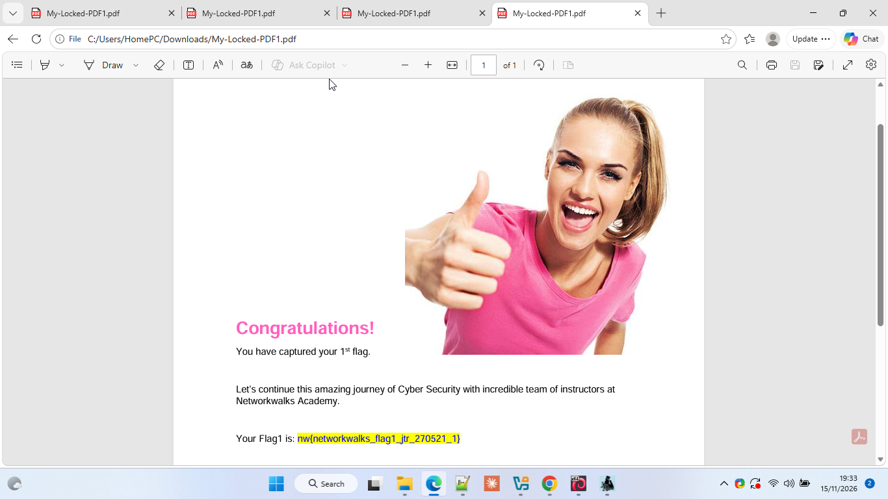
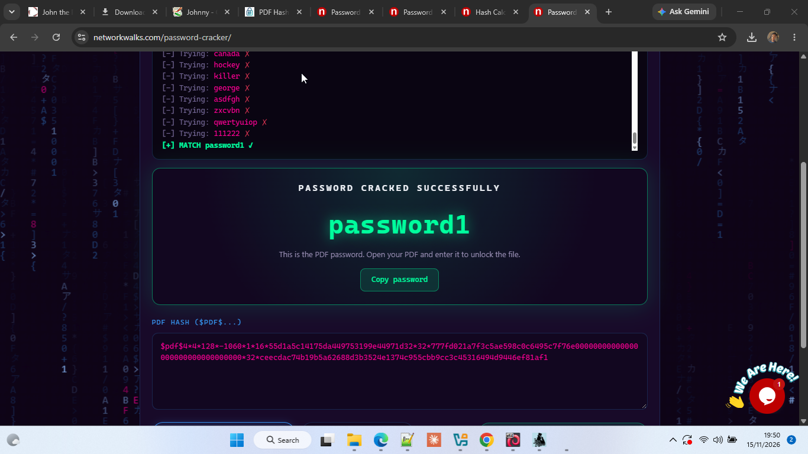

# Cybersecurity-Password-Security-and-Cracking-Labs
A hands-on password-cracking lab completed during Week 3 of my cybersecurity internship at NETWORKWALKS. This repository documents the process of recovering a password-protected PDF using both desktop-based tools (John the Ripper and Johnny GUI) and NETWORKWALKS' browser-based Hash Calculator and Password Cracker. The exercises demonstrate how password hashes are extracted and cracked through dictionary attacks, providing practical insight into password vulnerabilities and the importance of strong password security.

## Project Overview

As part of Week 3 of my cybersecurity internship at NETWORKWALKS, I completed two practical modules focused on PDF password recovery and dictionary-based password cracking.

The exercise involved working with a password-protected PDF file (`My Locked PDF1.pdf`) and exploring two different approaches to recovering its password.

**Module 1: Desktop-Based Password Cracking**

I installed John the Ripper and its Johnny GUI on Windows, extracted the PDF's password hash using an online hash extraction tool, and performed a dictionary attack to successfully recover the password.

**Module 2: Browser-Based Password Cracking**

I repeated the exercise using NETWORKWALKS' browser-based Hash Calculator and Password Cracker tools. Unlike the first approach, this method required no software installation, as the entire process was carried out directly through the browser.

**Outcome and Learning**

Both approaches successfully recovered the same password, demonstrating how dictionary attacks can exploit weak or commonly used passwords.

This exercise gave me practical exposure to password hash extraction, dictionary attacks, and password recovery techniques while reinforcing the importance of strong, unique passwords as a fundamental part of cybersecurity.

## Module 1 — Password Cracking with John the Ripper (JTR)

### Objective
Recover the password of `My Locked PDF1.pdf` using John the Ripper and its Johnny GUI on Windows through a dictionary attack.

### Tools & Resources
- **John the Ripper 1.9.0-jumbo-1:** 64-bit Windows binaries (ZIP).
- **Johnny GUI 2.2:** Windows graphical interface for John the Ripper.
- **PDF Hash Extractor:** [OnlineHashCrack PDF Hash Extractor](https://onlinehashcrack.com/tools-pdf-hash-extractor.php).

### Procedure

**1. Download and Set Up John the Ripper**
- Downloaded the Windows ZIP package from [Openwall](https://www.openwall.com/john/).
- Extracted the downloaded archive into the Downloads directory.

**2. Install Johnny GUI**
- Downloaded Johnny GUI 2.2 for Windows from [Openwall](https://openwall.info/wiki/john/johnny).
- Ran the installer to complete the setup.

**3. Configure Johnny to Use John the Ripper**
- Opened Johnny and navigated to Settings → Browse.
- Located the extracted John the Ripper directory.
- Selected `john.exe` from the `run` folder.
- Johnny successfully detected John the Ripper version 1.9.0-jumbo-1.

**4. Extract the PDF Password Hash**
- Uploaded `My Locked PDF1.pdf` to the online PDF Hash Extractor.
- Generated and copied the extracted hash, identified by its `$pdf$` prefix.

**5. Prepare the Hash File**
- Pasted the extracted hash into Notepad.
- Inspected the output and removed unwanted characters, such as a leading `b'`.
- Saved the file as `hash1.txt`, ensuring the file type was set to **All Files** to avoid an unintended `.txt.txt` extension.

**6. Execute the Dictionary Attack**
- Launched Johnny and selected **Open Password File**.
- Loaded `hash1.txt`.
- Clicked **Start New Attack** to initiate the password-cracking process.
- Allowed the attack to run until completion.

### Results and Verification

**Attack Status:** Successful

- **Recovered password:** `password1` (redacted from public documentation).
- **Verification:** Opened the original PDF and entered the recovered password.
- **Outcome:** The PDF was successfully unlocked.

### Key Learning

This exercise provided practical experience with PDF hash extraction, hash-file preparation, John the Ripper configuration, and dictionary-based password attacks. It demonstrated how weak or commonly used passwords can be recovered when their corresponding hashes are exposed to offline cracking techniques.

### Screenshot Evidence

### Flag

`nw{networkwalks_flag1_jtr_270521_1}`

## Module 2 — Password Cracking with NETWORKWALKS Tools

### Objective
Recover the password of `My Locked PDF1.pdf` using NETWORKWALKS' browser-based Hash Calculator and Password Cracker tools without installing additional software.

### Tools & Resources
- **NETWORKWALKS Hash Calculator:** https://networkwalks.com/hash-calculator/
- **NETWORKWALKS Password Cracker:** https://networkwalks.com/password-cracker/

### Procedure

**1. Obtain the PDF File**
- Downloaded `My Locked PDF1.pdf` from the internship lab page.
- Prepared the file for hash extraction.

**2. Extract the PDF Password Hash**
- Opened the NETWORKWALKS Hash Calculator.
- Uploaded the password-protected PDF.
- The tool identified the file as password-protected and generated a crackable hash in `$pdf$` format.
- Distinguished the PDF password hash from the generic MD5/SHA file checksums also displayed on the page.
- Copied the complete PDF hash for the next stage.

**3. Execute the Password-Cracking Process**
- Opened the NETWORKWALKS Password Cracker.
- Pasted the extracted `$pdf$` hash into the **PDF HASH** field.
- Selected the built-in wordlist.
- Clicked **START CRACKING** to initiate the process.

**4. Results and Verification**

**Attack Status:** Successful

- **Tool Response:** PASSWORD CRACKED SUCCESSFULLY.
- **Recovered password:** `password1` (redacted from public documentation).
- **Verification:** Opened the original PDF and entered the recovered password.
- **Outcome:** The PDF was successfully unlocked without requiring any locally installed password-cracking software.

### Key Learning

This exercise demonstrated how browser-based tools can simplify password hash extraction and dictionary-based password recovery. It also provided an opportunity to compare a locally installed solution (John the Ripper) with an online alternative, highlighting how different tools can achieve the same objective.

### Screenshot Evidence

